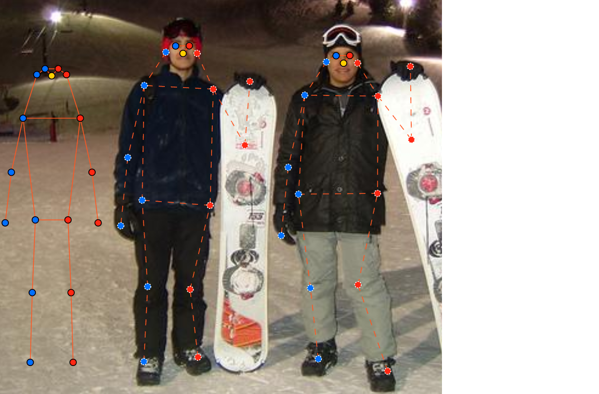
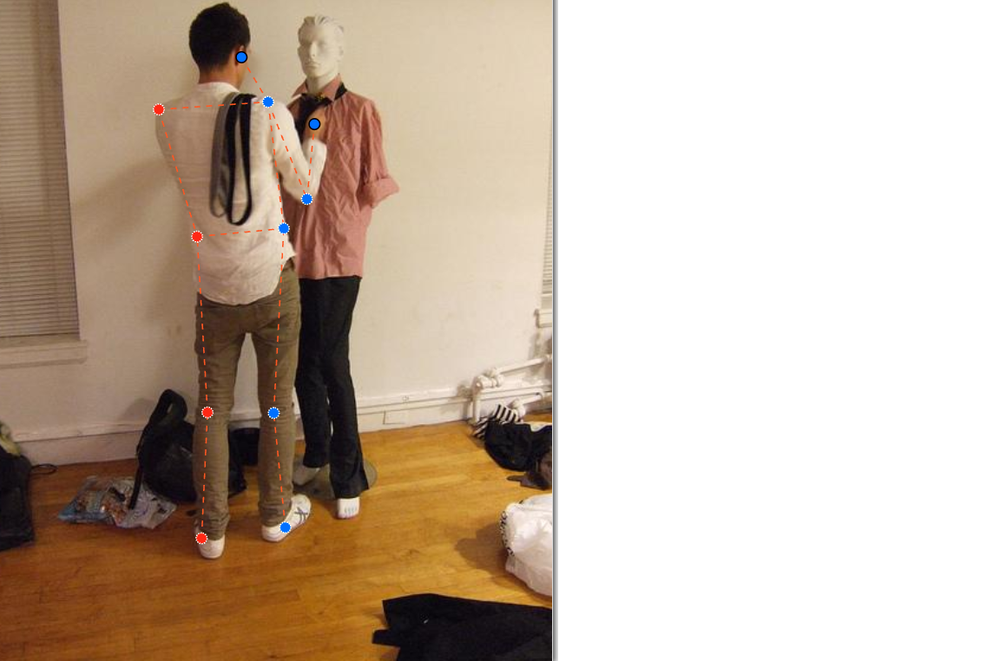
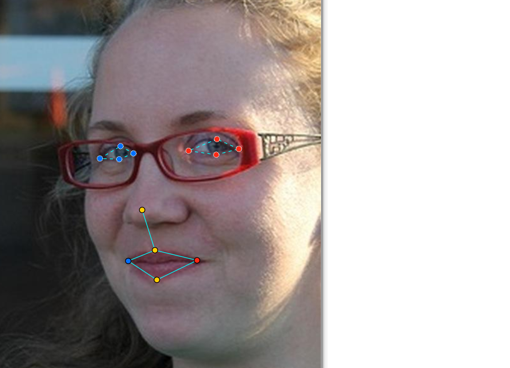
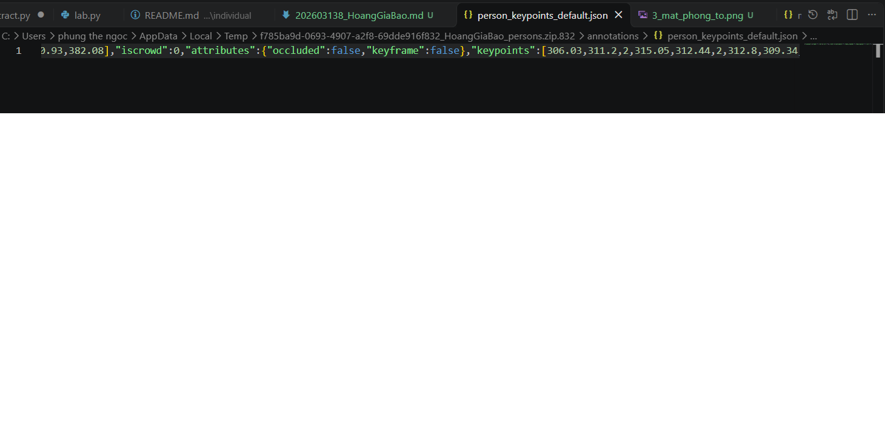

# Báo cáo cá nhân — HoVaTen-MSSV

Đổi tên file theo quy tắc `MSSV_HoTen.md`. Ví dụ: `20241234_NguyenVanAn.md`.

Dữ liệu: 12 ảnh người COCO val2017 (Lin et al., 2014) và 8 ảnh chân dung Wikimedia Commons, chỉ dùng trong lớp.

## 0. Thông tin học viên

Họ tên: Hoàng Gia Bảo

MSSV: 202603138

Email: baohoanggia9@gmail.com

Link repository: https://github.com/GBao294/K5-L2-DAY04-HOANGGIABAO-202603138-KeypointPose

Phiên bản CVAT (Help → About): [2.81.0]

Máy: [Hệ điều hành] · RAM [16] GB · chạy CVAT chế độ [đầy đủ/lite]

Bộ ảnh (src/exports/assignment.json do lab.py setup tạo): Có

Giờ bắt đầu: [12/11/2026 17h]

Giờ kết thúc: [13/11/2026 10h]

## 1. Kiểm tra label (CP0)

| Label | Kiểu | Số điểm | Tên điểm đúng bảng của lab? | Đúng thứ tự? | Số cạnh |
|---|---|---:|---|---|---:|
| `person` | Skeleton| 17 | Có | CÓ | 18 |
| `face` |Skeleton |13 |Có |Có |13 |

Mẫu `person` dựng theo người quay mặt về camera (các điểm `left_*` nằm bên phải khung mẫu)? Không

Cách đổi cờ `occluded` / `outside` cho **một điểm** trên phiên bản CVAT này (một câu):
Chọn skeleton, chọn đúng keypoint cần chỉnh rồi thay đổi thuộc tính hiển thị của điểm đó trong giao diện CVAT; kiểm tra lại cờ occluded hoặc outside trước khi lưu.
...

## 2. Số lượng đã gán và thời gian (CP1, CP2)

| Nhóm ảnh | Số ảnh | Số skeleton đã gán | Số người dưới 60 px (không gán) | Số poster / gương / màn hình bỏ qua | Thời gian (phút) |
|---|---:|---:|---:|---:|---:|
| `easy` | 5 |9 |0 | | |
| `occluded` | 3 |5 |0 | | |
| `back` | 2 |3 | 0| | |
| `small` | 1 |0 |2 | | |
| `crowd` | 1 |3|0 | | |
| `faces` | 8 | 8| — | | |

- Số ảnh người đã xong ở mốc phút 105: ___ / 10
- Thời gian thực tế (phút): CP1 ___ · CP2 ___ · CP3 ___
- Ảnh tốn thời gian nhất là ảnh nào, vì sao?
Ảnh nào nhiều người thì tốn nhiều thời gian và ảnh bị mờ 
...

## 3. Bảng ca khó (CP1, CP2)

Mỗi điểm bạn phân vân một dòng, nhất là phân vân giữa `v = 1` và `v = 0`, hoặc không chắc hướng người.
| Ảnh | Người / mặt | Điểm | Cờ đã chọn | Phân vân giữa | Lý do chọn |
|---|---|---|---:|---|---|
| | | | | | |
| | | | | | |
| | | | | | |
000000167027.jpg

Người #1

Các keypoint trên cơ thể

[CẦN KIỂM TRA]

v=1 / v=0

Skeleton có chiều cao vùng điểm chỉ khoảng 23 px; cần xác nhận kích thước người và khả năng quan sát

000000343057.jpg

Người #1

Knee, ankle

[CẦN KIỂM TRA]

Trái/phải

Công cụ tự kiểm phát hiện vị trí cặp đầu gối và mắt cá chân bị đảo so với các trường hợp khác

000000455536.jpg

Người #1

Wrist

[CẦN KIỂM TRA]

Trái/phải

Cần kiểm tra hướng cơ thể và xác định tay trái/phải theo góc nhìn của người được gán nhãn
## 4. Bảng tự review (CP3)

Đi từ ảnh cuối về ảnh đầu. 5 ảnh người (ít nhất 2 ảnh `back` hoặc `crowd`) và 3 ảnh mặt. Ít nhất 8 dòng, kể cả dòng `ok`. Ghi lỗi trước, sửa sau.

Mã lỗi dùng đúng một trong: `lr_swap`, `vis_flag`, `position`, `missing`, `extra`, `ok`.
Log báo lỗi như thế này nhưng mà khi check ảnh thì cảm thấy không sai?
  [CẢNH BÁO] 000000167027.jpg #1: các điểm chỉ trải cao 23 px (< 60 px). Người dưới 60 px không gán; nếu người cao hơn nhưng bị cắt khung thì bỏ qua cảnh báo này.
  [CẢNH BÁO] 000000167027.jpg #2: các điểm chỉ trải cao 27 px (< 60 px). Người dưới 60 px không gán; nếu người cao hơn nhưng bị cắt khung thì bỏ qua cảnh báo này.
  [CẢNH BÁO] 000000343057.jpg #1: cặp knee, ankle nằm ngược phía so với các cặp còn lại. Có thể đổi trái/phải một cặp (`lr_swap`), hoặc tay / chân bắt chéo thật: kiểm lại.
  [CẢNH BÁO] 000000455536.jpg #1: cặp wrist nằm ngược phía so với các cặp còn lại. Có thể đổi trái/phải một cặp (`lr_swap`), hoặc tay / chân bắt chéo thật: kiểm lại.
  [CẢNH BÁO] 000000542160.jpg #3: cặp knee, ankle nằm ngược phía so với các cặp còn lại. Có thể đổi trái/phải một cặp (`lr_swap`), hoặc tay / chân bắt chéo thật: kiểm lại.
| Ảnh | Người / mặt | Điểm | Mã lỗi | Ghi chú | Đã sửa? |
|---|---|---|---|---|---|
| | | | | | |
| | | | | | |
| | | | | | |
| | | | | | |
| | | | | | |
| | | | | | |
| | | | | | |
| | | | | | |

Tổng hợp số lỗi theo mã:

| `lr_swap` | `vis_flag` | `position` | `missing` | `extra` | `ok` |
|---:|---:|---:|---:|---:|---:|
|3 cảnh báo cần kiểm tra | 0|2 cảnh báo kích thước |0 |0 | -|

Điểm còn phân vân giữa `v = 1` và `v = 0` (ghi cả hai lựa chọn và lý do chọn): 
v = 1: sử dụng khi keypoint bị che khuất nhưng vẫn có thể xác định vị trí tương đối.

v = 0: sử dụng khi keypoint không nhìn thấy hoặc nằm ngoài khung hình.

Không nên tự động chuyển một điểm sang v = 0 chỉ vì vị trí khó nhìn; cần dựa trên khả năng quan sát thực tế.
...

## 5. Kiểm file xuất và kết quả tự kiểm (CP4)

Tự kiểm tay trong file JSON:

| File | Người / mặt kiểm (ảnh, thứ tự) | Số phần tử `keypoints` | Điểm `outside` ra `v = 0`, `occluded` ra `v = 1`? | `num_keypoints` khớp? |
|---|---|---:|---|---|
| `HoVaTen_persons.zip` | | | | |
| `HoVaTen_persons.zip` | | | | |
| `HoVaTen_faces.zip` | | | | |


Sau khi xuất, CVAT ghi `occluded` thành `v = ___` và `outside` thành `v = ___`. Tọa độ của điểm `outside` trong file là `0, 0` hay tọa độ cũ? ___

Một annotation person có 51 giá trị trong keypoints (17 điểm × 3).

Một annotation face có 39 giá trị trong keypoints (13 điểm × 3).

Có 82 điểm mang v = 0 nhưng vẫn giữ tọa độ cũ theo cách export của CVAT 2.x. Các điểm này được bỏ qua khi tính toán theo visibility flag.

Hai job đã chuyển sang completed trên CVAT? Có

Dán phần **TÓM TẮT** in ra từ `src/check_submission.py`:
(.venv) PS C:\Thư mục mới\K5-L2-DAY04-HOANGGIABAO-202603138-KeypointPose> python src/check_submission.py --persons src/exports/HoangGiaBao_persons.zip

=== src\exports\HoangGiaBao_persons.zip (label `person`) ===
  [CẢNH BÁO] 000000167027.jpg #1: các điểm chỉ trải cao 23 px (< 60 px). Người dưới 60 px không gán; nếu người cao hơn nhưng bị cắt khung thì bỏ qua cảnh báo này.
  [CẢNH BÁO] 000000167027.jpg #2: các điểm chỉ trải cao 27 px (< 60 px). Người dưới 60 px không gán; nếu người cao hơn nhưng bị cắt khung thì bỏ qua cảnh báo này.
  [CẢNH BÁO] 000000343057.jpg #1: cặp knee, ankle nằm ngược phía so với các cặp còn lại. Có thể đổi trái/phải một cặp (`lr_swap`), hoặc tay / chân bắt chéo thật: kiểm lại.
  [CẢNH BÁO] 000000455536.jpg #1: cặp wrist nằm ngược phía so với các cặp còn lại. Có thể đổi trái/phải một cặp (`lr_swap`), hoặc tay / chân bắt chéo thật: kiểm lại.
  [CẢNH BÁO] 000000542160.jpg #3: cặp knee, ankle nằm ngược phía so với các cặp còn lại. Có thể đổi trái/phải một cặp (`lr_swap`), hoặc tay / chân bắt chéo thật: kiểm lại.

----- TÓM TẮT (dán vào báo cáo mục 5) -----
- File person: HoangGiaBao_persons.zip
  Số ảnh: 12 · số skeleton `person`: 19 · mỗi annotation 51 số
  Skeleton theo ảnh: 000000023424=2, 000000090646=1, 000000162046=1, 000000167027=3, 000000177889=1, 000000183176=1, 000000210604=2, 000000302102=2, 000000343057=1, 000000455536=1, 000000542160=3, 000000558066=1
  Cờ v: v=2 94 (29%) · v=1 158 (49%) · v=0 71 (22%)
  num_keypoints trung bình: 13.3
- Ghi chú: 71 điểm v = 0 vẫn mang tọa độ cũ (CVAT 2.x xuất như vậy; chuẩn COCO ghi 0, 0). Không phải lỗi: điểm v = 0 bị bỏ qua khi huấn luyện và khi chấm.
- Số [LỖI]: 0 · số [CẢNH BÁO]: 5
Kết quả: ĐẠT (đọc lại từng cảnh báo ở trên)
(.venv) PS C:\Thư mục mới\K5-L2-DAY04-HOANGGIABAO-202603138-KeypointPose> python src/check_submission.py --faces src/exports/HoangGiaBao_faces.zip    

=== src\exports\HoangGiaBao_faces.zip (label `face`) ===

----- TÓM TẮT (dán vào báo cáo mục 5) -----
- File face: HoangGiaBao_faces.zip
  Số ảnh: 8 · số skeleton `face`: 8 · mỗi annotation 39 số
  Skeleton theo ảnh: face_137371=1, face_159828=1, face_204787=1, face_309728=1, face_380754=1, face_415073=1, face_425647=1, face_92028=1
  Cờ v: v=2 87 (84%) · v=1 17 (16%) · v=0 0 (0%)
  num_keypoints trung bình: 13.0
- Số [LỖI]: 0 · số [CẢNH BÁO]: 0
Kết quả: ĐẠT
(.venv) PS C:\Thư mục mới\K5-L2-DAY04-HOANGGIABAO-202603138-KeypointPose> 


Các `[CẢNH BÁO]` còn giữ nguyên và lý do:

...

## 6. Ảnh chụp màn hình

1. Label `person` trong label constructor (đủ 17 điểm có tên):

   

2. Một người quay lưng đã gán, cờ đã đặt:

   

3. Một khuôn mặt đã gán 13 điểm, phóng to vùng mắt:

   

4. Một đoạn JSON xuất của một người:

   

Nguồn ảnh: COCO val2017 / Wikimedia Commons.

## 7. Tự đánh giá

1. Lỗi bạn mắc nhiều nhất hôm nay, và cách bạn sẽ tránh ở dự án thật:
Chưa rõ
   ...

2. Một quy tắc bạn đề xuất thêm vào guideline (kèm ảnh ví dụ nếu có):
Ví dụ cho 1 số tình huống tay người khuất sau vật thể hoặc cả cánh tay ngay sau người nhưng mà bàn tay vẫn lộ ra ngoài? 1 là xem như không có phần tay đó hai là dự đoán khuỷu tay?
   ...

3. Nhãn của bạn đi vào model ở đâu? Chọn một lỗi bạn đã sửa và nói nó sẽ làm model học sai thế nào (heatmap, trọng số trong loss, hay bước lật ảnh):

   ...

## 8. Khó khăn và lỗi kỹ thuật

...

## Bonus (nếu làm)

### B1 — 3 ảnh người khó thêm

| Ảnh | Số skeleton | Số người dưới 60 px | Ca khó nhất |
|---|---:|---:|---|
| | | | |
| | | | |
| | | | |

Kết quả `src/check_submission.py` cho `HoVaTen_bonus_persons.zip`:

```text
(dán ở đây)
```

### B2 — 5 ảnh khuôn mặt đen trắng / hồng ngoại

Ảnh không màu khó hơn ở điểm nào? Kính râm trên ảnh hồng ngoại có còn là `v = 1` không?

...

### B3 — Model so với nhãn của tôi (không tính điểm)

- Demo đã dùng:
- Ảnh đã thử:

1. Model có trả điểm cho khớp bị che, hay khớp ngoài ảnh không? Confidence ở các điểm đó thế nào?

   ...

2. Với người quay lưng, model có đổi trái/phải không?

   ...

3. Bộ điểm của model có giống 17 điểm COCO không?

   ...

## 9. Tài liệu tham khảo và công cụ AI đã dùng

...
